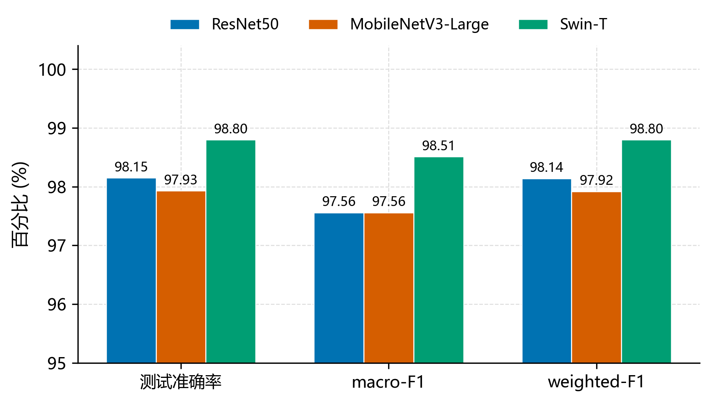
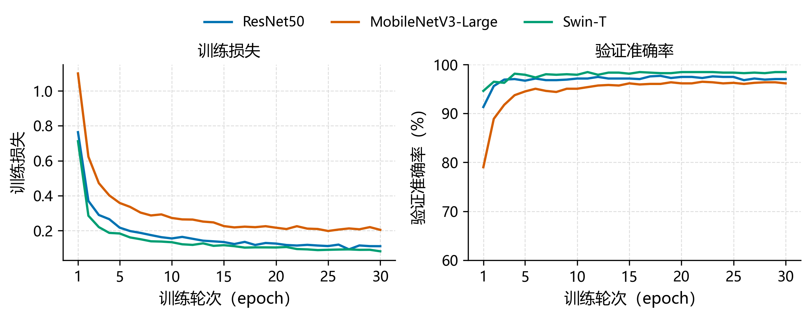
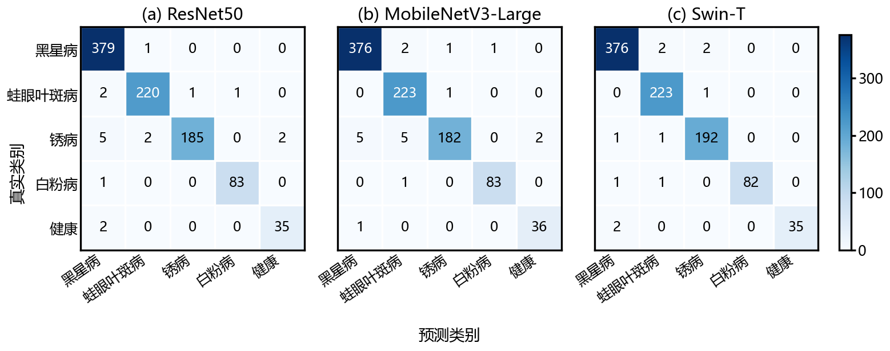
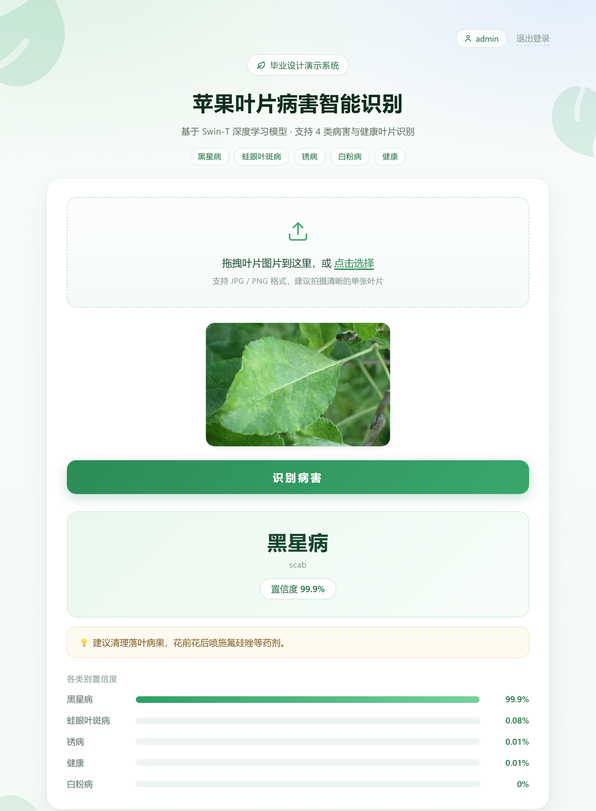

# 苹果叶片病害识别（Apple Leaf Disease Recognition）

基于深度学习的苹果叶片病害图像分类：**5 类、9133 张**，在同一数据划分与训练配置下对比 **ResNet50 / MobileNetV3-Large / Swin-T**，并提供一个 Flask 网页 demo（上传图片 → Top-3 类别概率 + 低置信度拒识）。

> 本科毕业设计项目 · 2027 届 · 人工智能专业

## 主要结果

测试集 919 张，三模型完全同口径（同一划分、同一预训练来源、同一训练策略）：

| 模型 | 测试准确率 | macro-F1 | weighted-F1 | 单张推理 |
|---|---:|---:|---:|---:|
| ResNet50 | 98.15% | 97.56% | 98.14% | 3.76 ms |
| MobileNetV3-Large | 97.93% | 97.56% | 97.92% | 4.02 ms |
| **Swin-T** | **98.80%** | **98.51%** | **98.80%** | 8.77 ms |



## 方法

- **数据**：5 类（黑星病 / 蛙眼叶斑病 / 锈病 / 白粉病 / 健康），共 9133 张，分层 8:1:1 划分（训练 7304 / 验证 910 / 测试 919），随机种子 42。
- **迁移学习**：加载 ImageNet-1K 预训练权重，替换分类头为 5 类。
- **训练策略**：Adam 优化器，**主干 lr=1e-5、分类头 lr=1e-4 的分层学习率**，余弦退火，30 epochs，batch 32，输入 224×224，ImageNet 归一化。
- **数据增强**：RandomResizedCrop(224)、RandomHorizontalFlip、ColorJitter(brightness=0.2, contrast=0.2)。验证/测试：Resize(256) + CenterCrop(224)。
- **对比实验**：ResNet50、MobileNetV3-Large、Swin-T 使用完全相同的数据划分与训练配置，保证可比。





## 数据说明

- 数据来源：苹果病害图像识别挑战赛公开数据（原始 9 类 10211 张；本项目保留 5 类、剔除样本过少的小类）。
- **数据集未包含在本仓库**（体积约 1.4 GB）。请自行准备并整理为以下布局：

```
data/
├── train/<class>/   # 7304 张
├── val/<class>/     # 910 张
└── test/<class>/    # 919 张
```

`<class>` 取 `scab`（黑星病）、`frogeye_leaf_spot`（蛙眼叶斑病）、`rust`（锈病）、`powdery_mildew`（白粉病）、`healthy`（健康）。

## 项目结构

```
.
├── src/
│   ├── train.py        # 三模型训练 + 测试评估 + 曲线/混淆矩阵/指标导出
│   └── evaluate.py     # 用本地测试集复现三模型指标，生成混淆矩阵与错误样本图
├── demo/
│   ├── app.py          # Flask 网页 demo（Swin-T，5 分类，低置信度拒识）
│   ├── templates/      # 登录页 / 上传识别页
│   └── static/         # 页面用图（训练曲线、混淆矩阵）
├── results/
│   ├── metrics/        # 三模型的 metrics.json / history.json（真实结果）
│   └── training_log.csv
├── docs/figures/       # 论文/README 配图
├── weights/            # 模型权重目录（.pth 不入库，见 weights/README.md）
└── requirements.txt
```

## 快速开始

### 1. 安装依赖

```bash
pip install -r requirements.txt
```

> PyTorch 建议按[官网](https://pytorch.org/get-started/locally/)选择对应 CUDA 版本安装，例如：
> `pip install torch torchvision --index-url https://download.pytorch.org/whl/cu121`

### 2. 训练

```bash
# 数据目录用环境变量指定（默认 /root/autodl-tmp/data）
DATA_DIR=./data python src/train.py resnet50
DATA_DIR=./data python src/train.py mobilenet_v3_large
DATA_DIR=./data python src/train.py swin_t
```

训练会输出 `*_best.pth`、`*_metrics.json`、`*_history.json`、混淆矩阵与训练曲线。

### 3. 评估

把三模型权重放到 `results/metrics/` 下（`resnet50_best.pth` 等），然后：

```bash
python src/evaluate.py
```

### 4. 网页 demo

```bash
# 把 Swin-T 权重放到 weights/swin_t_best.pth，或设置 APPLE_LEAF_WEIGHTS 指向它
python demo/app.py
```

浏览器打开 <http://127.0.0.1:5000>（演示账号：`admin / 123456`）。

| 上传页 | 识别结果页 |
|---|---|
|  |  |

## 说明

- 本项目为学生毕业设计，仅用于学习与交流。
- 类别不平衡（黑星病 3029 vs 健康 289，约 10.5:1）未做类别加权，论文以 macro-F1 为主指标并如实讨论小类波动；后续可引入类别加权/过采样进一步改进。

## 作者

骆荣辉 · 854443837@qq.com
